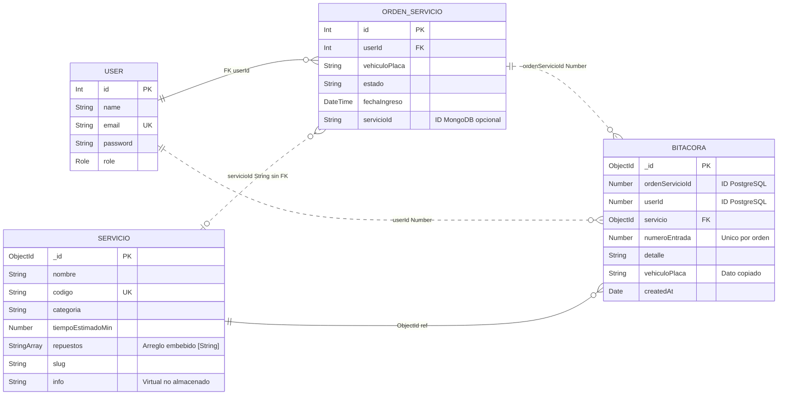
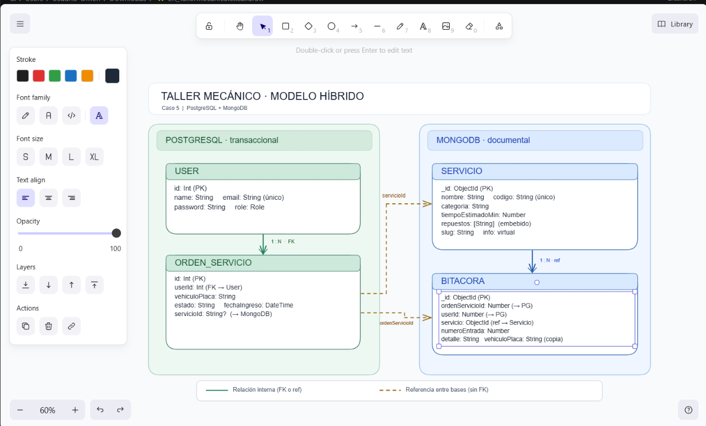

# Tarea individual U2 · Modelo híbrido PostgreSQL + MongoDB

**Estudiante:** Erick Alejandro Silva Culqui  **N.º de lista:** 5  **Caso:** 5 · Taller mecánico

> Mismo formato que el workload del material de Modelado (lección 2.2) y que el ejemplo resuelto de la clínica
> (`docs/ejemplo_clinica/Workload_clinica_hibrida.md`). Cada operación agrega la fila **Base**.

## 1. Workload

### 1.1 Casos de uso
- Un taller mecánico registra las órdenes de servicio de los vehículos que recibe para mantenimiento o reparación.
- El personal consulta el catálogo de servicios disponibles, como cambio de aceite, revisión de frenos y mantenimiento del motor.
- Cada orden registra el vehículo, el servicio solicitado, su estado y el usuario responsable.
- Los técnicos agregan entradas a la bitácora para informar sobre diagnósticos, reparaciones y avances realizados.
- El personal consulta las órdenes junto con la información del servicio y el historial de trabajos.
- El encargado administra el catálogo y puede eliminar un servicio únicamente si ninguna orden lo está utilizando.

### 1.2 Datos principales (cuántos actores, cuántos registros, cuánto tiempo se guardan)
- Usuarios: 1 encargado y 4 técnicos registrados en el sistema.
- Servicios: aproximadamente 15 tipos de mantenimiento y reparación.
- Órdenes de servicio: aproximadamente 20 por día.
- Bitácora: aproximadamente 2 entradas por orden, es decir, 40 registros diarios. Una orden puede tener más entradas cuando la reparación lo requiera.
- Vehículos atendidos: aproximadamente 20 por día, identificados mediante su placa en la orden.
- Período: las órdenes y sus bitácoras se conservarán durante 3 años para consultar los trabajos realizados.
- Las cantidades son estimaciones para desarrollar el modelo de un taller pequeño.

### 1.3 Suposiciones (lo que puede cambiar)
- Cada orden pertenece a un usuario registrado, que es el responsable de su gestión.
- Una orden tiene un servicio principal del catálogo, aunque el campo puede ser opcional.
- Los servicios pueden necesitar diferentes repuestos y tiempos estimados.
- El estado de una orden puede ser pendiente, en_proceso o finalizada.
- Una orden puede tener varias entradas en su bitácora, sin un número máximo fijo.
- Cada entrada de la bitácora tendrá un número consecutivo dentro de su orden para evitar duplicados.
- La placa de un vehículo normalmente no cambia y puede copiarse a la bitácora para facilitar las consultas históricas.
- Un servicio no puede eliminarse mientras existan órdenes que lo referencien.

### 1.4 Operaciones (mínimo 6, una tabla por operación)

| Actor: | Personal del taller |
|---|---|
| Descripción: | Consulta los servicios disponibles para seleccionar el mantenimiento de un vehículo |
| Tipo de operación: | Lectura |
| Datos en la operación: | nombre, código, categoría, repuestos[], tiempoEstimadoMin |
| Frecuencia: | Varias veces durante la jornada |
| Tasa: | 200 consultas / día |
| Base: | MongoDB, porque el catálogo tiene campos variables y se consulta frecuentemente |

| Actor: | Encargado del taller |
|---|---|
| Descripción: | Registra o actualiza un servicio del catálogo |
| Tipo de operación: | Escritura |
| Datos en la operación: | nombre, código, categoría, tiempoEstimadoMin, repuestos[] |
| Frecuencia: | Aproximadamente 10 veces al mes |
| Tasa: | 10 operaciones / mes |
| Base: | MongoDB, porque los repuestos y las características cambian según el servicio |

| Actor: | Técnico responsable |
|---|---|
| Descripción: | Crea una orden de servicio para un vehículo, seleccionando un servicio existente |
| Tipo de operación: | Escritura |
| Datos en la operación: | vehiculoPlaca, estado, fechaIngreso, servicioId, userId del JWT |
| Frecuencia: | Cada vez que ingresa un vehículo |
| Tasa: | 20 órdenes / día |
| Base: | Las dos: MongoDB valida que exista el servicio y PostgreSQL guarda la orden con integridad |

| Actor: | Técnico responsable |
|---|---|
| Descripción: | Consulta las órdenes junto con el nombre y tiempo estimado de sus servicios |
| Tipo de operación: | Lectura |
| Datos en la operación: | id, vehiculoPlaca, estado, fechaIngreso, servicioId, nombre, tiempoEstimadoMin |
| Frecuencia: | Durante la revisión de los trabajos pendientes |
| Tasa: | 100 consultas / día |
| Base: | Las dos: PostgreSQL obtiene las órdenes y MongoDB recupera los servicios mediante $in y Map |

| Actor: | Técnico responsable |
|---|---|
| Descripción: | Agrega una entrada a la bitácora de una orden para registrar los trabajos realizados |
| Tipo de operación: | Escritura |
| Datos en la operación: | ordenServicioId, numeroEntrada, detalle, servicio, userId del JWT, vehiculoPlaca copiada |
| Frecuencia: | Aproximadamente 2 registros por orden |
| Tasa: | 40 entradas / día |
| Base: | Las do: PostgreSQL valida la orden y su propietario; MongoDB guarda la entrada |

| Actor: | Técnico responsable |
|---|---|
| Descripción: | Consulta la bitácora y el número de registros de una orden |
| Tipo de operación: | Lectura |
| Datos en la operación: | ordenServicioId, numeroEntrada, detalle, vehiculoPlaca, createdAt, información del servicio |
| Frecuencia: | Al revisar el avance y el historial de una reparación |
| Tasa: | 80 consultas / día |
| Base: | MongoDB, utilizando orden, populate y aggregate para obtener registros y conteos |

| Actor: | Técnico responsable |
|---|---|
| Descripción: | Actualiza el estado de una orden conforme avanza la reparación |
| Tipo de operación: | Escritura |
| Datos en la operación: | id de la orden, estado |
| Frecuencia: | Una o varias veces durante el mantenimiento |
| Tasa: | 40 actualizaciones / día |
| Base: | PostgreSQL, porque el estado de la orden debe mantenerse consistente |

| Actor: | Encargado del taller |
|---|---|
| Descripción: | Elimina un servicio que ya no se ofrece, comprobando que ninguna orden lo utilice |
| Tipo de operación: | Escritura |
| Datos en la operación: | _id del servicio, órdenes relacionadas y bitácoras asociadas |
| Frecuencia: | Ocasionalmente |
| Tasa: | 1 operación / mes |
| Base: | Las do: PostgreSQL comprueba las referencias y MongoDB elimina el servicio y los registros relacionados si corresponde |
### 1.5 Entidades

- **PostgreSQL**
  - User: usuarios autenticados mediante JWT.
  - OrdenServicio: vehículo, estado, fecha, usuario responsable y referencia al servicio.
  - Relación 1:N entre User y OrdenServicio mediante userId.

- **MongoDB**
  - Servicio: catálogo de mantenimientos, con repuestos[] embebidos.
  - Bitacora: registros de los avances de una orden.
  - Relación 1:N entre Servicio y Bitacora mediante una referencia ObjectId.

- **Entre bases (sin FK)**
  - OrdenServicio.servicioId → Servicio._id (String opcional).
  - Bitacora.ordenServicioId → OrdenServicio.id (Number).
  - Bitacora.userId → User.id (Number).
  - Bitacora.vehiculoPlaca: copia de OrdenServicio.vehiculoPlaca.
### 1.6 Observaciones (qué domina: lectura o escritura, qué crece sin límite, qué necesita integridad)
- Predominan las consultas del catálogo, de las órdenes y de las bitácoras. Esto justifica guardar los servicios como documentos preparados para consultar.
- La bitácora crece con cada trabajo realizado y no tiene un número fijo de entradas por orden. Por eso se almacena en una colección independiente.
- Las órdenes necesitan integridad porque deben conservar un responsable, un vehículo y un estado consistente.
- Los repuestos se embeben en Servicio porque normalmente se muestran junto con el mantenimiento y forman parte de su descripción.
- Las referencias entre PostgreSQL y MongoDB se comprueban desde los servicios de la API, porque no existen claves foráneas entre ambas bases.
- Se necesitan índices para buscar órdenes por servicio, impedir entradas duplicadas y consultar rápidamente las bitácoras.

## 2. ¿PostgreSQL o MongoDB?

| Entidad | ¿Transacciones o choques? | ¿Otras dependen por FK? | ¿Forma variable? | ¿Crece sin límite? | ¿Se lee mucho más? | Base |
|---|---|---|---|---|---|---|
| User | Sí, requiere identidad y autenticación consistentes | Sí, OrdenServicio depende de User | No | No de forma relevante | Se consulta durante la autenticación | PostgreSQL |
| OrdenServicio | Sí, necesita mantener correctamente el estado y responsable | Sí, depende de User mediante FK | No, sus campos son definidos | Crece con las órdenes registradas | Se consulta y actualiza frecuentemente | PostgreSQL |
| Servicio | No requiere transacciones relacionales | No tiene FK dentro de PostgreSQL; se valida desde el servicio | Sí, los repuestos y características varían | El catálogo es limitado | Sí, se consulta más de lo que se modifica | MongoDB |
| Bitacora | No requiere transacciones relacionales para cada entrada | Utiliza referencias verificadas desde la aplicación | Sí, el detalle depende del trabajo | Sí, puede recibir muchas entradas por orden | Se consulta para revisar el historial | MongoDB |

## 3. Relaciones dentro de MongoDB: embeber o referenciar

| Relación | Cardinalidad | ¿Se lee junto? | ¿Cambia seguido? | ¿Crece sin límite? | Decisión |
|---|---|---|---|---|---|
| Servicio - repuestos[] | 1:N de pocos elementos | Sí, cuando se consulta un servicio | Cambia cuando se modifica el mantenimiento | No, es una lista limitada | Embeber el arreglo repuestos[] dentro de Servicio |
| Servicio - Bitacora | 1:N | A veces, al consultar registros de trabajos | Sí, cada nueva intervención genera registros | Sí, puede crecer continuamente | Referenciar mediante Bitacora.servicio como ObjectId |
| Bitacora - datos del servicio | N:1 | Sí, para mostrar el servicio relacionado | El catálogo puede actualizarse | No dentro de una entrada | Utilizar populate para consultar el Servicio referenciado |

## 4. ERD híbrido (notación pata de gallo, como el material 2.1)
Dos zonas, PostgreSQL y MongoDB; cada entidad con sus campos y tipos; lo embebido dentro de la entidad (`campo: [Tipo]`).
Línea continua: FK de PostgreSQL o `ref` de Mongoose. **Línea punteada: referencia entre bases** (sin FK).
Puede entregarlo como imagen (draw.io, Lucidchart) o con Mermaid, que GitHub dibuja solo:

**Zona PostgreSQL:User y OrdenServicio.

Zona MongoDB: Servicio y Bitacora.

Las relaciones punteadas representan referencias entre bases que se comprueban desde los servicios de Express. No son claves foráneas reales. El campo `info` es virtual y no se almacena en MongoDB.

## 5. Referencias

| Referencia | Se guarda como | La garantiza | Se une con |
|---|---|---|---|
| OrdenServicio.userId → User.id | Int, FK de PostgreSQL | PostgreSQL mediante Prisma | Relación Prisma |
| OrdenServicio.servicioId → Servicio._id | String? en PostgreSQL | Servicio de Express con isValidObjectId y exists de Mongoose | $in + Map en el servicio |
| Bitacora.ordenServicioId → OrdenServicio.id | Number en MongoDB | Servicio de Express con Prisma findUnique | Consulta Prisma mediante el ID |
| Bitacora.userId → User.id | Number en MongoDB | JWT y comprobación del propietario de la orden | Comparación con el usuario autenticado |
| Bitacora.servicio → Servicio._id | ObjectId con ref en Mongoose | Servicio de Express y referencia del modelo | populate("servicio") |

## 6. Dato copiado entre bases (desnormalización)
- Dato: `vehiculoPlaca` se copia desde `OrdenServicio.vehiculoPlaca`, almacenado en PostgreSQL, hacia `Bitacora.vehiculoPlaca`, almacenado en MongoDB.
- Por qué (operación del workload): cuando un técnico consulta la bitácora necesita identificar rápidamente el vehículo sin hacer una consulta adicional a PostgreSQL por cada registro.
- Costo: si se corrige o modifica la placa en PostgreSQL, las entradas anteriores conservarán el valor copiado. Esto genera duplicación de información y requiere decidir si se mantienen los valores históricos o si se actualizan las copias.
## 7. Endpoints

| Método y ruta | Base(s) | Respuestas posibles |
|---|---|---|
| POST /api/auth/register | PostgreSQL | 201, 400 |
| POST /api/auth/login | PostgreSQL | 200, 400 |
| POST /api/servicios | MongoDB | 201, 400, 401, 409 |
| GET /api/servicios?q=&fields=&sort= | MongoDB | 200 |
| GET /api/servicios/:id | MongoDB | 200, 400, 404 |
| PUT /api/servicios/:id | MongoDB | 200, 400, 401, 404 |
| DELETE /api/servicios/:id | PostgreSQL + MongoDB | 200, 400, 401, 404, 409 |
| POST /api/ordenes-servicio | PostgreSQL + MongoDB | 201, 400, 401, 404 |
| GET /api/ordenes-servicio | PostgreSQL + MongoDB | 200, 401 |
| GET /api/ordenes-servicio/:id | PostgreSQL + MongoDB | 200, 400, 401, 403, 404 |
| PATCH /api/ordenes-servicio/:id/estado | PostgreSQL | 200, 400, 401, 403, 404 |
| DELETE /api/ordenes-servicio/:id | PostgreSQL + MongoDB | 200, 400, 401, 403, 404 |
| POST /api/bitacoras | PostgreSQL + MongoDB | 201, 400, 401, 403, 404, 409 |
| GET /api/bitacoras | MongoDB | 200, 401 |
| GET /api/bitacoras/resumen | MongoDB | 200, 401 |
| DELETE /api/bitacoras/:id | MongoDB + PostgreSQL | 200, 400, 401, 403, 404 |

**Índices previstos:**
- PostgreSQL: `@@index([servicioId])` en OrdenServicio.
- MongoDB: índice único compuesto `{ ordenServicioId: 1, numeroEntrada: 1 }` en Bitacora. Permite varias entradas por orden, pero impide repetir su número.
- MongoDB: índice `{ servicio: 1, createdAt: -1 }` para consultar las bitácoras relacionadas con un servicio y ordenarlas por fecha.

Regla de eliminación: si una orden utiliza un servicio, su eliminación devuelve 409. Si ninguna orden lo utiliza, se eliminan sus registros relacionados en MongoDB antes de borrar el servicio. Si una operación entre bases falla, el sistema informa el error y no debe considerar completada una eliminación parcial.